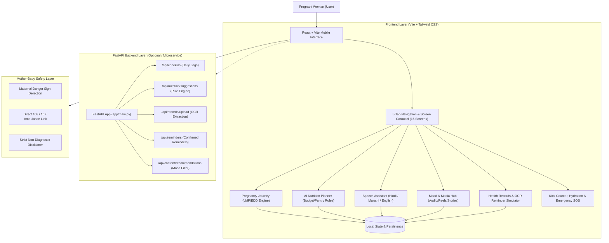

# GarbhaSaathi - System Architecture

## Key Architectural Principles
1. **Zero-Delay Emergency Flow:** Maternal danger signs trigger immediate guidance to medical care without getting stalled in AI conversation or questionnaires.
2. **Deterministic Nutrition Rules First:** Low-cost, trimester-adjusted nutrition suggestions derived from reviewed clinical guidance (ICMR-NIN guidelines for Indian pregnant women).
3. **Explicit User Confirmation for Reminders:** OCR or text extractions are never activated automatically. The mother confirms the date, time, and medication instructions before any reminder is created.
4. **Resilient Offline-First Architecture:** The React web app runs completely self-contained in modern browsers with `localStorage` persistence, Web Speech API for voice, and audio player capabilities even without an active internet connection.
